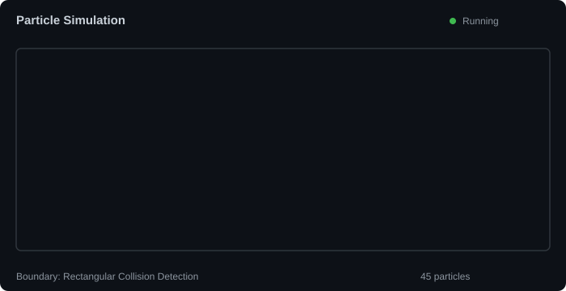

<h1 align="center">Hi 👋, I'm Zaid</h1>
<h3 align="center">AI Developer · Building LLM-powered apps and agentic tools</h3>

  

  
  
  

---

## About me

- 🤖 Building AI applications with LLMs, from resume analysis to Claude skills
- 🧠 Interested in Machine Learning, LLMs, Agentic AI, and the road to AGI
- 🌐 Shipping real websites and apps for real businesses
- 🌱 Always learning through hands-on projects and open source

## Featured projects

| Project | What it is | Built with |
| --- | --- | --- |
| [**HireSignal**](https://github.com/ztuniio/hiresignal) · [Live demo](https://my-portfolio-ztqu.vercel.app/) | AI resume scanner and CV-writing service for job seekers in Pakistan and the Gulf | React, TypeScript, Gemini API, Express |
| [**LinkedIn Profile Optimizer**](https://github.com/ztuniio/linkedin-profile-optimizer) | A Claude skill that rewrites LinkedIn profiles into paste-ready, keyword-aware copy | Claude Skills, Prompt Engineering |
| [**GymFlow**](https://github.com/ztuniio/GymFlow) | Android workout tracker with progress charts, fitness calculators, and streaks | Kotlin, Jetpack Compose, Room |
| [**ChaiGPT Cafe**](https://github.com/ztuniio/chaigpt) | Website for a cafe and restaurant in Jamshoro, with menu tabs and a photo gallery | HTML, CSS, JavaScript |
| [**Hik2Adhai Cafe**](https://github.com/ztuniio/hik2adhai) | Single-page website for a coffee and chai cafe in Jamshoro | HTML, CSS, JavaScript |
| [**CODSOFT UI/UX**](https://github.com/ztuniio/CODSOFT) | Figma designs from the CODSOFT internship: signup flow, restaurant menu, e-commerce | Figma |

## Tech stack

**AI & ML**

  

**Web & Mobile**

  

**Cloud & Tools**

  

## GitHub stats

  
  

<i>Open to collaborations on AI projects. Feel free to reach out on LinkedIn.</i>

